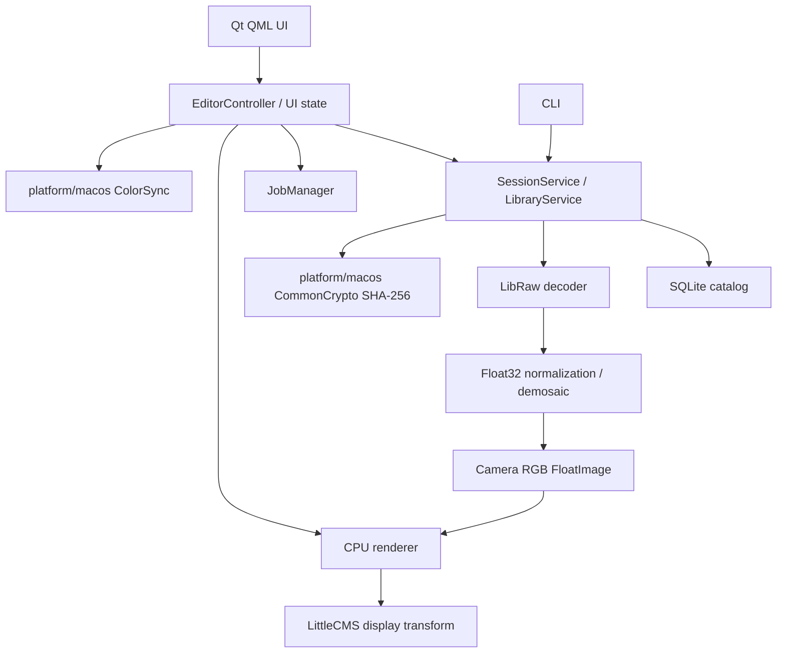

# Architecture

## Layers and dependencies



The core uses C++20 and has no Qt dependency. QML declares layout and bindings;
it does not open SQLite, decode RAW or process pixels. `SessionService` is shared
by desktop, CLI and integration tests. macOS-specific code lives under
`platform/macos`; there are no speculative Windows abstractions.

## Implemented modules

- `core/raw`: bounded LibRaw sensor decoding, metadata and validation. Does not
  invoke `dcraw_process`. `unpack_thumb` is confined to Library thumbnails.
- `core/image`: Float32 Bayer data, bilinear interpolation, camera color matrix.
- `core/render`: area-averaged camera RGB preview and shared CPU Develop reference path.
- `core/color`: scene-linear sRGB to arbitrary RGB monitor ICC, via LittleCMS.
- `core/metadata`: typed EXIF and descriptive/XMP values, ordered creators and exact label text; absent numbers remain `std::optional`.
- `core/edits`: validated typed Develop document; global schema version 8.
- `core/presets`: validated subset merge of implemented settings groups.
- `core/catalog`: SQLite connection per worker operation and migrations through 21, with pre-migration backups.
- `core/jobs`: bounded queue, interactive priority, cancellation, state, progress
  and error storage.
- `apps/shared`: open/restore/save and import/recovery workflows independent of GUI.
- `apps/desktop`: Qt editor controller, bounded paged LibraryModel and asynchronous thumbnail provider.
- `apps/cli`: explicit-catalog machine-readable commands.

Source implementations of masks, bounded caches, local AI and category-based
semantic search are described in the phase 0.6–0.9 development records. They are
unbuilt and unqualified until the final release campaign.

## Named processing versions

`EditSnapshot` is an explicit, bounded, versioned serialization of the complete
EditDocument, including local masks and retouch. It is independent of sparse
presets and does not include original image pixels or photo metadata. Catalog
schema 18 stores immutable documents in `edit_versions`, with per-photo name
uniqueness, quotas and revision-guarded rename/delete. Serialization and SQLite
work run on the editor I/O worker; lists read metadata only. Restore enters the
existing Undo/autosave/render path after geometry and generation checks.
See [phase-0.9 version semantics](docs/PHASE9_DEVELOPMENT.md#named-processing-versions).
The implementation has not been built or qualified.

## Preview histogram and clipping

`ImageHistogram` consumes processed linear-sRGB samples after geometry, noise,
sharpening and local adjustments, before monitor conversion and display overlays.
An optional renderer analysis request enables a bounded regular sampling grid
and transient clipping overlays. Existing non-desktop renderer callers use the
default disabled analysis request. Export options/documents remain independent.
`RenderedPreview` couples the QImage and histogram in the same bounded cache
entry; cache accounting includes both. The existing render generation check
publishes them together and rejects superseded work. The pipeline-v4 cache key
includes clipping and Point Color range modes as well as ICC, resolution and diagnostic/mask state.
See [ADR 0028](docs/adr/0028-preview-histogram.md) and the unqualified
[workflow/limits](docs/PHASE9_DEVELOPMENT.md#histogram-and-clipping).

## White balance estimation

`WhiteBalance` shares the existing manual gain model between DevelopPipeline
and a bounded Temperature/Tint fit. `WhiteBalanceSampler` uses optics/retouch
source-preview RGB and CropGeometry for a gray-world crop estimate or a neutral
patch, with alpha-aware interpolation and conservative As Shot sample admission.
`EditorWhiteBalance` owns cancellation/generation guards and commits one ordinary
EditHistory change. The resolved Custom values use the existing document,
catalog, preset and export representation; no new persisted mode is introduced.
The picker waits for its stable Fit canvas. See [ADR 0029](docs/adr/0029-white-balance-estimation.md).
All runtime and photographic qualification is deferred.

## Local diagnostics and crash capture

`DiagnosticSession` owns a private, unique process directory and a bounded
asynchronous JSONL writer. Its API accepts event/level enums and boolean state,
never free-form errors, photo names, paths or credentials. Log rotation is per
process; retention only visits recognized inactive sessions under Luma's own
diagnostics root while holding their session locks. Acceptance launches do not
start capture or modify the user's diagnostic history.

The macOS adapter uses a pinned source build of PLCrashReporter 1.12.2. Each
process gets its own reporter base path, capped binary report and no in-process
symbolication. Existing reports are converted to text on a background worker
after their owning process exits; raw reports are retained. Crash capture never
calls SQLite or the Qt logger from a signal/exception callback. The existing
catalog marker and pre-migration backups remain responsible for recovery.

Preferences exposes the local diagnostic folder. The shareable diagnostic JSON
includes capability/status counts only; logs and raw/text crash reports are not
automatically included or uploaded. Crash records can contain process/OS details
and binary paths. Keep them private and preserve dSYMs separately for final
symbolication. All capture, rotation and crash/recovery behavior is unqualified.

## RAW and color pipeline

```text
LibRaw open/unpack (integer sensor samples)
→ validate sensor bounds / memory budget / Bayer CFA
→ subtract per-channel and patterned black levels in floating point
→ normalize against sensor white level
→ project bilinear demosaic in camera RGB
→ area-averaged camera RGB preview, max 2560 px (export retains original size)
→ optional sensor-linear optics (vignette gain + per-channel radial lookup)
→ As Shot/manual WB gains
→ LibRaw camera-to-sRGB matrix
→ scene-linear Float32 sRGB (unclipped)
→ Exposure = RGB × 2^EV
→ luminance tone and color corrections, Curves and HSL
→ manual luminance/color noise reduction
→ luminance sharpening
→ upright perspective Transform + Crop / rotate / flip / straighten geometry
→ monitor ICC through LittleCMS
→ oriented 8-bit RGBA display raster
```

8-bit conversion occurs only at the display boundary. The preview retains
negative RGB and values above 1 until the output transform. An empty monitor
profile explicitly targets sRGB. On macOS the controller reads the active
window's ColorSync monitor profile and schedules a new CPU render on screen
change. This is an SDR display implementation; HDR presentation, gamut warnings,
embedded input ICC, selectable output spaces and proofing are future work.

The Qt scene graph normally uses its macOS Metal RHI for presentation. Pixel
processing remains CPU in M0. The planned Metal backend must implement this
reference pipeline with numerical tolerance tests, not replace it with an
unrelated rendering graph.

## Threading, autosave and shutdown

The GUI owns editor state. Small bounded preset collection I/O is synchronous; RAW, render and catalog workflows use workers. The I/O job lane has one worker so open, restore and
catalog saves are ordered. Interactive preview uses a separate one-worker lane.
New render requests cancel obsolete jobs; revision checks prevent stale images
from replacing current UI state. Cancellation is checked per row and supplied
to LibRaw's progress callback. No exception crosses a Qt queued callback.

Develop updates debounce for 180 ms. SQLite writes use `BEGIN IMMEDIATE`, WAL,
`synchronous=FULL`, foreign keys and a busy timeout. Normal window close waits
asynchronously for the pending transaction. On failure the UI retains the edit,
reports the error and offers retry. A failed save blocks close and photo switch.
A forced kill can lose an uncommitted debounce interval; the last committed
edit remains durable. This is not described as zero-loss recovery.

## Catalog and integrity

Migration 1 creates `assets`, `edit_documents`, `session`, `schema_migrations`
and indexes for checksum, capture date and rating. Every imported source has a
UUID, canonical path and SHA-256. Metadata is persisted separately from edits.
Opening an existing path preserves the edit document and checks its checksum. Modified
originals are not silently reassociated with prior edits. Missing sources cause
a visible error; their catalog row and edits remain intact.

Migration 3 adds collections/membership and checkpointed import sessions/items.
Future migrations add versions, keywords, export sessions and render cache entries. A newer unsupported schema is refused rather
than overwritten. Automated backups and crash recovery UI are planned for 0.9.

## Memory and cache

Inputs are capped at 512 MB and 100 MP; LibRaw's raw allocation budget is 512 MB.
One Develop/export decode runs on the editor I/O lane; at most two independent
Library thumbnail jobs independently decode RAW for saved-edit renders. Full Float32 data is released after generation of
the current 2560 px floating-point preview. At 1:1 the future viewer will request
a full render; M0 exposes Fit only. Library has a 512 MiB disk thumbnail cache, oldest-use eviction, two workers and
a 96-request admission limit. Thumbnail keys include source checksum, saved edit
revision, canonical full edit fingerprint and edited-pipeline version; output is
bounded to 384 px in sRGB. The metadata LRU has 16×128 rows. Future full-size render
cache keys will also include requested resolution and display ICC profile hash.

## AI providers

AI is planned. Denoise, segmentation and embeddings will have independent core
provider interfaces, with optional Core ML implementations in `platform/macos`.
No cloud calls or telemetry are present. New provider contracts must be added
with an ADR and real workflow tests.

Cancellation uses a shared atomic token defined in `core/jobs/Cancellation.h`.
It avoids dependence on `std::stop_token`, which is absent from Xcode 16 libc++
despite C++20 language support, and is used consistently by decoder/render jobs.

## Develop and export

ADR 0006 defines the shared camera-space pipeline, reference Temperature/Tint,
luminance remapping and immutable export snapshots. Version 2 migration rebuilds
the edit table transactionally and preserves M0 exposure/revision/timestamps.
Independent correction bits disable processing while retaining parameter values.

The bounded per-session history records one slider gesture as one operation.
Undo/Redo updates the same document and uses the same autosave/render path.
Session changes establish a new history baseline; history is not durable yet.
`EditHistory` associates retained documents with stable IDs and commit-time
descriptions. Its browser reads metadata only; arbitrary navigation moves the
existing stack states and performs one autosave/render update. Generation-scoped
UI handles and revision-guarded clear refuse stale requests. A historical state
can be captured by the named-version worker without replacing the current edit.
The eight-language dialog exposes the session lifetime and preserves viewport
across model refreshes. See [ADR 0027](docs/adr/0027-session-history-browser.md).

Export rechecks source SHA-256 and decodes full resolution on the I/O lane.
ImageIO encodes JPEG/PNG/TIFF16, using an explicitly embedded deterministic sRGB
ICC profile. It never uses monitor ICC. TIFF16 is quantized directly from Float32,
without an 8-bit intermediate. A sibling temporary output is finalized and
synced before atomic link/rename installation. Queued load/export cancellation
uses independent cooperative tokens, so completion callbacks still release UI
state even if cancellation precedes job execution.

## Library and import

ADR 0007 records the paged model and checkpoint protocol. Filtering and pages
run on the read worker; edits run on a separate write worker; import has its own
cooperative cancellation token. Selection is by asset UUID independently of page
residency; explicit Select All stores IDs for the filtered set. No SQLite, source
file stat or RAW decoding runs on the GUI thread. Normal close requests both
editor-save completion and import cancellation/checkpoint completion.

Copy records a staged item before filesystem installation, streams into an owned
sibling temporary file, checks SHA-256, fsyncs and links without replacement.
Asset insertion and terminal item state share a SQLite transaction. Recovery
atomically claims a dead-owner session before processing it; concurrent apps
cannot recover the same session. Duplicate policy is persisted in the journal.
Changed published files are preserved; originals are never removed by recovery.
SQLite WAL setup retries BUSY/LOCKED for at most three seconds at concurrent
initialization; upgrades recheck the schema under BEGIN IMMEDIATE. Current-schema readers
do not take a writer lock and remain usable during WAL writes.

## Advanced color and updates

Catalog migration 3→4 retains Library state and preceding corrections while adding
four curve parameters, normalized point arrays and eight HSL bands. Child rows
and the main edit row are one transaction. Saved-but-incomplete advanced rows are
reported as corruption. Neutral defaults preserve older renders. The PCHIP point
curves and parametric/HSL processing run in perceptual sRGB around the existing
linear pipeline; export shares this implementation.

UpdateController bridges QML to Sparkle's standard updater through an ARC-managed
Objective-C++ delegate. Scheduled checks use gentle reminders in the bell;
installation remains Sparkle's native UI. A deferred installation block waits
for EditorController pending/failed saves, load, export and Library writes/imports.
The embedded Ed25519 public key validates archives. The private key stays in the
release owner's Keychain or the repository Actions secret. Qt/core never process
an update ZIP or replace their own running executable.

## User presets

ADR 0009 originally defines schema-1 preset JSON and atomic shared collection storage beside
the catalog. A core subset merge preserves every excluded group and the As Shot
mode. The desktop owns a separate temporary hover snapshot, which affects only
preview rendering. Apply/Paste send the merged document through existing history,
autosave and export code. Preset storage has no RAW or catalog paths in exported
documents. ADR 0011 extends it to schema 2 with the Detail group and legacy reads; ADR 0012
extends it to schema 3 with noise parameters, accepting schema 1/2. ADR 0013 extends it to schema 4
with an optional sixth Crop group, accepting schema 1/2/3. ADR 0014 extends it to schema 5
with an optional seventh Optics group, accepting schema 1–4.
ADR 0023 adds bounded offline Camera Raw XMP import. Sparse parameter selections
use preset/library schema 7 and travel through merge, preview, batch and JSON
round-trips; legacy whole-group documents retain schema 6. Unsupported XMP
settings are reported without flattening nested looks. Catalog/edit schemas do not change.

## Batch settings

ADR 0010 defines whole-selection transactions and a disk-backed TEMP Undo journal
on a dedicated worker connection. Single-photo and batch writes share the validated
parent/curve/HSL writer. Conflict checks occur under the same write lock as Undo.
The editor drains autosave before an external batch and adopts an active-document
snapshot captured before commit, without issuing a stale follow-up save. The UI
locks mutation and guards close/update readiness through the complete operation.

## Detail sharpening

NoiseReductionPass follows pointwise DevelopPipeline with an optional luminance/
chroma component buffer and separable joint bilateral filtering. SharpeningPass
consumes its reduced values without reapplying pointwise corrections and runs
before ICC/quantization in display, PNG/JPEG and TIFF16. It retains two luminance
planes and a bounded row ring, with per-row cancellation. Preview carries its
reduction scale so Radius stays in original-image pixels. Option diagnostics are
transient editor display state and never enter persistence/export. Catalog 7/edit
6 and preset 4 preserve legacy settings with neutral noise/sharpening defaults;
see ADR 0011 and ADR 0012.

Manual NoiseReductionPass precedes sharpening in the shared CPU path;
see [ADR 0012](docs/adr/0012-detail-noise-reduction.md) for controls, buffer bounds,
neutral migration and preset compatibility.

CropGeometry shares inverse mapping and processed-linear sampling for preview,
TIFF16 export and targeted source selection. Crop editing displays the uncropped
transformed canvas without storing tool/guide state. Crop bounds-only gestures
skip unchanged canvas rendering while maintaining autosave/Undo. See [ADR 0013](docs/adr/0013-crop-geometry.md).

## Optical calibration

`core/lens` consumes a typed, generated representation of the pinned Lensfun
v0.3.4 database, separate CC BY-SA data, with no Lensfun library dependency.
Camera crop factor, calibration crop factor/aspect and pixel-center coordinates
normalize radial models across preview/full-resolution and sensor sizes.
Per-channel CA lookup operates in camera RGB before matrix mixing; PA gain is
applied at each source sample before bilinear interpolation. One corrected RGB
buffer is allocated only for active effects. The same corrected input feeds
Develop/Noise/Sharpening in CPU preview and TIFF16 export; PNG/JPEG delegate to
CPU rendering. Targeted tools sample this corrected input after Crop inverse mapping.

Polynomial derivative bounds give a conservative radial factor envelope,
providing safe inward scaling over the whole rectangular sensor for all channels.
Positive monotonic radial maps and positive vignette attenuation are enforced;
invalid calibration produces an explicit render/export failure. Correction
strength 0 or a disabled profile bypasses all resampling/copying. Missing or
ambiguous data remain unavailable and preserve source pixels. Camera matching,
mount compatibility and manual profile IDs never use a guessed sensor crop factor.


## Perspective Transform

ADR 0015 adds a bounded typed homography and manual controls, composed in upright
coordinates with EXIF/Crop before a single bilinear sample. CropGeometry exposes
coverage to preview/export; transparent exterior never replicates source edges.
Constrain Crop uses inverse-pole exclusion and convex-corner containment. Targeted
tools use the same inverse map. Neutral/disabled geometry preserves exact pixels.

Guided line endpoints are transient. Two vertical/horizontal pairs solve vanishing
directions and projective/affine rectification; only the matrix is stored. Auto
runs bounded Gaussian/Sobel/polarity-Hough line detection in a separate cancellable
worker, then uses the same solver with coverage, noise and safety checks. Revision
guards prevent stale results. Tool modes only enable pointers on matching renders.
Catalog 9/edit 8/preset 6 add Geometry as an eighth independent settings subset;
compound matrices are validated atomically in editor, persistence and batch paths.


## Built-in photographic filters

ADR 0016 represents eight immutable looks as existing Curve/HSL presets (subset
12). BuiltinPresets owns declarative parameters and stable `builtin:` IDs. The
controller exposes a separate built-in list, resolves it for ordinary hover/apply/
batch snapshots and refuses mutations. User storage and preset schemas are
unchanged. JSON import creates an editable UUID copy. The shared renderer handles
all processing; photographic fixtures and reviewed spatial metrics complement
sensor/QML/history/batch acceptance.


## Edited thumbnail snapshots

ADR 0017 uses a dedicated read transaction for parent/Curve/HSL edits and saved
revision. Canonical full preset JSON, source checksum and pipeline version identify
cache entries; duplicate source bytes and restored revision numbers cannot alias
different edits. Bounded shared CPU rendering includes calibration/metadata and
Detail preview scale. Initial and cached responses return the same encoded JPEG.

Successful autosaves emit editsSaved independently of active-photo revision;
BatchController invalidates cached rows after successful apply/Undo/Redo. A model
URL nonce invalidates Qt's image cache without model resets or full-catalog scans.
Snapshot cache identities and Qt source replacement isolate late results. PhotoCard
retries remain declarative bindings and reset with each new URL. Existing worker,
admission and disk budgets remain; phase-0.6 optimization is separate.


## Advanced export boundary

`ExportOptions` owns pure typed validation and output dimensions. `LinearOutput`
shares developed/corrected geometry, alpha-aware resize and output sharpening.
macOS adapters handle ICC output, photographic metadata filtering, CoreText/image
watermarks and ImageIO encoders. An original DNG writer streams calibrated 16-bit
LinearRaw samples; the narrowly identified Luma DNG reader uses D50 forward
calibration explicitly. No Adobe SDK or general RAW color-profile expansion.

`ExportSettings` validates a versioned JSON representation for desktop profiles.
`ExportController` coordinates autosave, plans immutable asset/edit/settings
snapshots and runs one SessionService export at a time on its own JobManager.
Pause happens between files; cooperative cancellation joins before destruction.
Only final atomic file installation holds a short catalog writer transaction,
checking originals again to include photos registered during rendering. Source
encoding/preview/MakerNote fields never override the destination codec settings.
No edit/catalog schema migration is needed. See docs/EXPORT.md and ADR 0018.


## Shared image ingestion

ADR 0020 introduces `DecodedImage` (`DecodedRaw` remains a compatibility alias) and
`PhotoDecoder`. Session/Library/recovery/thumbnails use this dispatcher. LibRaw
recognizes camera RAW containers before native TIFF dispatch so an embedded preview
cannot become the Develop source. Ordinary images use ImageIO primary full pixels,
ICC-to-linear-sRGB float conversion, photographic metadata and EXIF orientation.
No catalog/edit migration or runtime codec dependency is added.

`FloatImage::alpha` is optional straight coverage; empty retains the exact opaque
RAW path. Preview averaging, optics, noise reduction, sharpening and geometry
normalize by coverage. PNG/TIFF preserve alpha; JPEG/DNG flatten against black.
The native adapter validates header/decoded dimensions and completeness, and checks
cancellation before/after native operations and during conversion. See
[image support](docs/IMAGE_SUPPORT.md) for the user-visible format/limit contract.

## Local adjustments

ADRs 0022/0024 add ordered local adjustment layers to the complete EditDocument.
Catalog 11 stores a mandatory bounded version-2 mask child per asset, atomically
with global edit schema 8 and saved revision. Catalog 10→11 validates and upgrades
all version-1 gradients in one transaction, including rollback on a later corrupt
row; older apps refuse catalog 11. Global preset merges preserve target masks;
batch journals include the entire mask document for conflict detection and Undo.
Thumbnail identity includes canonical mask bytes and uses edited-v4.

A mask contains a base Linear/Radial/Brush/Luminance/Color primitive plus ordered
Add/Subtract/Intersect operands. Composition uses a+b−ab, a(1−b), ab; operand
inversion applies before composition, final inversion/opacity after it. Brush
stores bounded vector centerlines with stroke radius/opacity/erase. Continuous
capsules are unioned within a stroke and composited across strokes; a segment
BVH avoids full-size coverage images and per-pixel heap allocation.

LocalAdjustmentPass applies eight pointwise Light/Color operators after global
Develop/Detail in scene-linear sRGB and before geometry sampling. Range selectors
reference this pre-local image, independent of layer order or display ICC.
Luminance uses clamped encoded linear-Y; Color uses normalized Euclidean distance
in clamped encoded sRGB. This is not Adobe matching or a perceptual Delta E claim.
The asynchronous source sampler shares reference passes and rejects stale jobs.

Preview and LinearOutput share coverage and adjustments; optically corrected
source coordinates are normalized before EXIF/Crop/Transform. Brush radius uses
the original source aspect, independent of rounded preview dimensions. The
CropGeometry forward/inverse pair projects editing handles, cursor and gestures.
The alpha-aware coverage overlay is excluded from export/thumbnail paths.
Tool/selection/overlay state is transient. See
[local mask workflow, limits and acceptance](docs/LOCAL_ADJUSTMENTS.md).

## UX qualification

The separate `luma_ux_tests` target loads production QML and controllers over an
isolated generated-image catalog. Qt Test input drives native Quick windows;
test identifiers add no shipping behavior. A parent Python process serializes
screen access, supervises a UI heartbeat, records evidence, and validates SQLite
and original hashes. Restart cases use separate OS processes. A test-only SQLite
VFS supplies bounded, explicit storage faults without altering production I/O.

The scenario inventory and capability manifest distinguish unexecuted tests from
absent features. No unexecuted blocking case qualifies a release; every applicable
blocking case requires three clean repetitions. See [ADR 0025](docs/adr/0025-ux-regression-release-gate.md)
and [runner documentation](tests/ux/README.md). Local performance measurements are
kept separate from hosted CI and from input dispatch timing.

## Creative controls and Library extensions

`CreativeSettings` is a typed parameter registry plus bounded codec. Schema 19
stores it separately from the existing scalar edit table. The shared CPU pipeline
adds Point Color/Grading, Presence and post-crop effects; active creative color
selects the CPU fallback. Snapshot codec 2 and preset codecs 8/9 retain older readers.
`EditorCreative` performs cancellable source sampling and local Auto Adjust; its
results enter ordinary edit history. `EditorCompare` freezes two edit documents
and publishes two temporary images through the existing PreviewProvider.

`SmartRule` compiles bounded recursive predicates to bound SQL. Schema 20 stores
revisioned rules; the Library reuses its pagination/filtering and refresh lifecycle.
`ImportOptions` stores immutable source workflow choices. Schema 21 adds session
options and per-item plans/metadata/Move state to the existing journal. Metadata
and Develop settings commit with asset registration; source removal follows file
and backup completion. [ADR 0030](docs/adr/0030-functional-completion.md) specifies
recovery, naming, backup scope and preservation behavior. All are unqualified.
